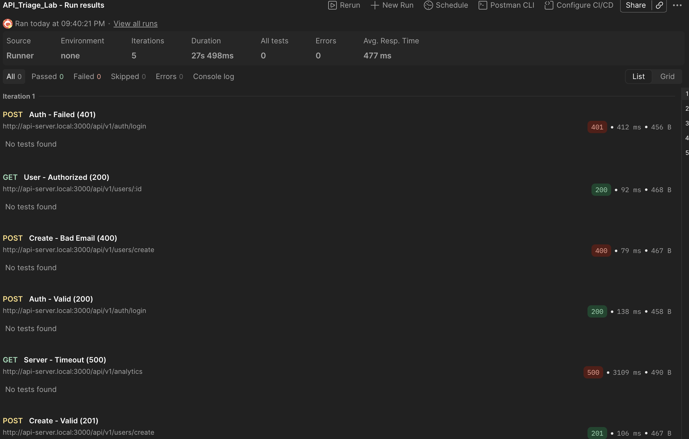
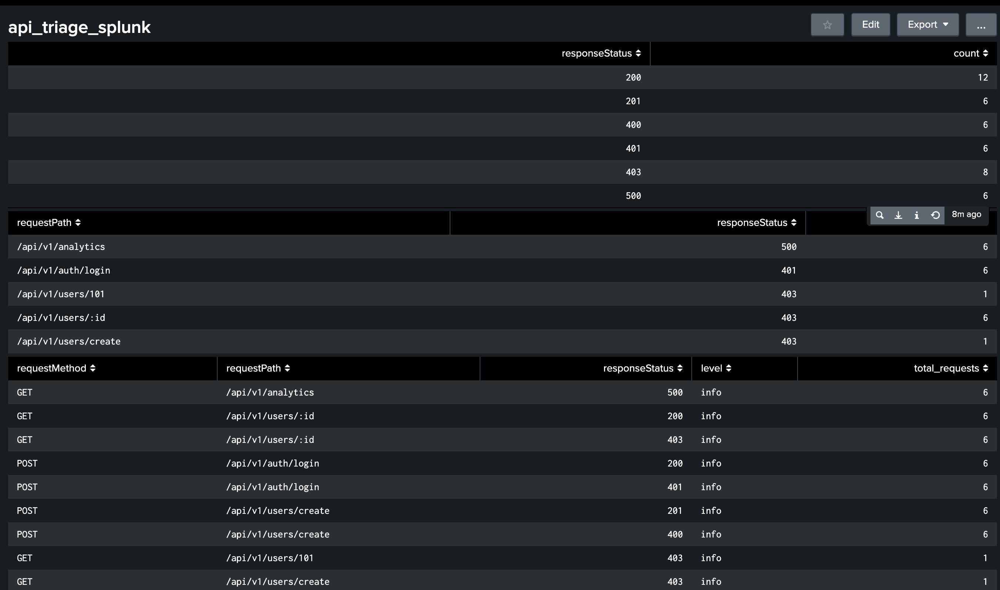

API Triage & Observability Lab

I built this lab to simulate real-world API support and log triage. It runs a headless REST API on an Ubuntu Server VM, sends mixed normal (200)/(201) and error requests from Postman on macOS, automates server restarts and log pulls with Bash over SSH/SCP, and routes logs for Splunk analysis.

## Phase 1: Ubuntu Server & API Setup
- Hosted a headless Mockoon API server on an Ubuntu Server VM listening on port `3000`.
- Locked down the firewall with UFW so only SSH (`22/tcp`), mDNS (`5353/udp`), and the API port (`3000/tcp`) are open.
- Built 4 endpoints to test normal responses alongside auth, validation, and timeout failures:
  - `POST /api/v1/auth/login` - Returns `200` for valid credentials (`admin` / `secretsauce`) or `401` for invalid logins.
  - `GET /api/v1/users/:id` - Requires `Authorization: Bearer dummy-token-123` (`200`) or rejects with `403`.
  - `POST /api/v1/users/create` - Validates email format using regex (`201`) or returns `400` on bad input.
  - `GET /api/v1/analytics` - Injects a `3000ms` delay and returns `500` to simulate a slow backend timeout.

## Phase 2: Bash Automation (SSH & SCP)
- `start_server.sh` (Ubuntu VM) - Pulls the latest JSON config from GitHub, stops any running Mockoon process, waits 1 second for port `3000` to clear, and starts the server in the background with `nohup`.
- `fetch_logs.sh` (macOS) - Copies `mockoon_api.log` down to my Mac over key-authenticated `scp` and adds a `YYYY-MM-DD_HHMMSS` timestamp to the filename so old logs don't get overwritten.
- Configured `.gitignore` to keep raw `.log` files and SSH keys out of GitHub.

## Phase 3: Traffic Generation & Log Triage
- Created a 7-request Postman collection alternating between valid requests and errors, running 5 iterations (35 total requests) to generate mixed traffic and `3000ms` latency spikes.
- Pulled the resulting telemetry logs locally for Splunk ingestion and error-rate analysis.

## Issues Hit & Fixes Along the Way
- Dynamic IPs across different Wi-Fi networks: Without router admin access to set static IPs, the VM's address changed across networks. Installed `avahi-daemon` on Ubuntu and allowed UDP port `5353` in UFW so `api-server.local` resolves over mDNS anywhere.
- GitHub web firewall block: Hit a temporary web firewall block during setup. Generated an `ed25519` SSH keypair (`~/.ssh/id_ed25519`) and authenticated directly over SSH (`git@github.com`) instead.
- Broken JSON syntax in 403 payload: Typed a single quote (`'`) instead of a comma (`,`) in the `403` JSON response, which broke strict JSON formatting. Fixed the punctuation in `API_Triage_Lab.json` so log parsers can read the fields cleanly.
- `ENOENT` path errors in `start_server.sh`: The script initially failed because of relative working paths and referencing a generic `./mockoon-env.json` instead of `./API_Triage_Lab.json`. Added `cd ~/api_triage_lab` at the top of the script, fixed the filename, and added a `sleep 1` pause after `pkill` so port `3000` closes cleanly before restarting.